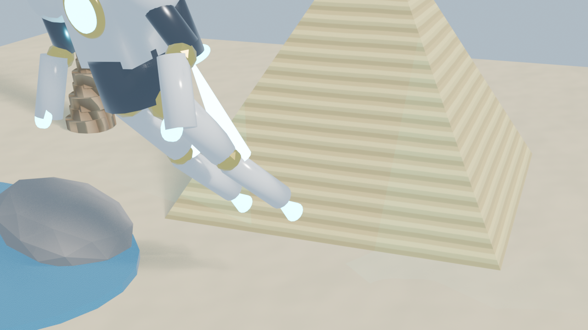

# 🎨 Blender MCP

<h3 align="center">Real-Time 3D Scene Generation, PBR Materials, Asset Importing & Automated Rendering.</h3>

<p align="center">
Empower LLMs and AI agents (Claude Desktop, Cursor, Antigravity, VS Code) to interact with Blender 3D in real time through natural language.
</p>

## Overview

**Blender MCP Server** is a high-performance Model Context Protocol (MCP) server that provides a direct bidirectional bridge between AI models and Blender 3D.

It executes commands safely on Blender's main application thread via a non-blocking background timer loop, allowing AI assistants to create geometric primitives, apply realistic PBR shader materials, import 3D assets (GLTF, OBJ, FBX), position cameras and lighting rigs, and trigger high-resolution Cycles and Eevee rendering runs automatically.

## 🏛️ Architecture & How It Works

```
┌────────────────────────┐           stdio (MCP Protocol)           ┌────────────────────────┐
│  AI Client / Host LLM  │ ────────────────────────────────────────> │   Blender MCP Server   │
│ (Claude, Cursor, AGY)  │ <──────────────────────────────────────── │ (blender_mcp_server.py)│
└────────────────────────┘                                          └───────────┬────────────┘
                                                                                │
                                                                    HTTP REST   │ (Port 9876)
                                                                    (Localhost) │
                                                                                ▼
┌────────────────────────────────────────────────────────────────────────────────────────────┐
│                                     Blender Application                                    │
│  ┌───────────────────────────────┐                  ┌───────────────────────────────────┐  │
│  │   Blender MCP Bridge Addon    │ ─── Timer Queue ─>│    Blender Main Thread (bpy)      │  │
│  │      (blender_addon.py)       │                  │ (Mesh, Materials, Render, Nodes)  │  │
│  └───────────────────────────────┘                  └───────────────────────────────────┘  │
└────────────────────────────────────────────────────────────────────────────────────────────┘
```

1. **Host AI Agent / Client** communicates with `blender_mcp_server.py` over standard input/output (`stdio`) following the Model Context Protocol.
2. **FastMCP Server** translates tool calls into structured HTTP requests to the local Blender Bridge server (`http://127.0.0.1:9876`).
3. **Blender MCP Bridge Addon** receives the request and queues execution onto Blender's **Main Thread** via `bpy.app.timers`. This ensures thread safety, rock-solid stability, and zero UI lockups during script execution and rendering.

## 🛠️ Available MCP Tools

| Tool Name | Parameters | Description |
| :--- | :--- | :--- |
| `blender_status` | *(None)* | Verifies connection to Blender, reports version and status. |
| `blender_get_scene_summary` | *(None)* | Returns JSON metadata of all objects, lights, cameras, materials, and active render engine. |
| `blender_create_primitive` | `primitive_type`, `name`, `location`, `rotation`, `scale`, `size` | Creates 3D primitives (`cube`, `uv_sphere`, `ico_sphere`, `cylinder`, `cone`, `torus`, `plane`, `monkey`, `light`, `camera`). |
| `blender_assign_material` | `object_name`, `material_name`, `base_color`, `metallic`, `roughness`, `emission_color`, `emission_strength` | Generates a Principled BSDF PBR material and assigns it to a 3D object. |
| `blender_clear_scene` | `keep_camera`, `keep_lights` | Clears objects from the scene while optionally retaining cameras and lights. |
| `blender_render_image` | `output_path`, `resolution_x`, `resolution_y` | Renders the scene from the active camera and saves image to disk. |
| `blender_import_3d_model` | `source_path_or_url`, `name`, `location`, `rotation`, `scale` | Downloads (from URL) or loads local `.glb`, `.gltf`, `.obj`, or `.fbx` models into the scene. |
| `blender_execute_script` | `code` | Executes arbitrary Python code with full access to the `bpy` API. |

## 🚀 Installation & Setup Guide

### 1. Prerequisites
* **Blender 3.0+** (Tested on Blender 3.6 LTS, 4.0, 4.1, 4.2+)
* **Python 3.10+**

### 2. Install Python Dependencies
```bash
pip install -r requirements.txt
```
*Or install the package in editable mode:*
```bash
pip install -e .
```

### 3. Start the Blender MCP Bridge
You can load the bridge into Blender via two easy methods:

#### Method A: Quick Run via Scripting Tab (Recommended for rapid testing)
1. Open **Blender**.
2. Click the **Scripting** workspace tab at the top.
3. Click **Open** and select `blender_addon.py`.
4. Click **Run Script** (`Alt + P`).
5. In the 3D Viewport, press `N` to open the Sidebar and switch to the **MCP Bridge** tab. Verify the status displays `Online (Port 9876)`.

#### Method B: Permanent Add-on Installation
1. In Blender, go to `Edit` > `Preferences` > `Add-ons`.
2. Click `Install...` (or `Install from Disk`) and choose `blender_addon.py`.
3. Enable the checkbox for **Development: Blender MCP Bridge**.
4. The bridge server will start automatically upon launching Blender.

## ⚙️ Client Configurations

Configure your favorite AI agent / MCP host to connect to the server:

### 🟣 Claude Desktop
Add to your `claude_desktop_config.json` (`%APPDATA%\Claude\claude_desktop_config.json` on Windows or `~/Library/Application Support/Claude/claude_desktop_config.json` on macOS):

```json
{
  "mcpServers": {
    "blender": {
      "command": "python",
      "args": [
        "/path/to/blender-mcp/blender_mcp_server.py"
      ],
      "env": {
        "BLENDER_BRIDGE_URL": "http://127.0.0.1:9876",
        "PYTHONIOENCODING": "utf-8"
      }
    }
  }
}
```

### 🟢 Antigravity / Gemini CLI
Add to `mcp_config.json`:

```json
{
  "mcpServers": {
    "blender": {
      "command": "python",
      "args": [
        "/path/to/blender-mcp/blender_mcp_server.py"
      ],
      "env": {
        "BLENDER_BRIDGE_URL": "http://127.0.0.1:9876"
      }
    }
  }
}
```

### 🔵 Cursor IDE
Add to `.cursor/mcp.json`:

```json
{
  "mcpServers": {
    "blender": {
      "command": "python",
      "args": [
        "/path/to/blender-mcp/blender_mcp_server.py"
      ]
    }
  }
}
```

### 🟠 VS Code (Roo Code / Cline)
Add to MCP settings:

```json
{
  "blender": {
    "command": "python",
    "args": [
      "/path/to/blender-mcp/blender_mcp_server.py"
    ]
  }
}
```

## 🔒 Security Notice

* **Localhost-Only Binding:** The bridge server binds strictly to `127.0.0.1` and rejects non-loopback connections.
* **Host Header & Origin Validation:** Protects against DNS rebinding and cross-site scripting (CSRF) attempts from external browsers. Wildcard CORS (`Access-Control-Allow-Origin: *`) has been removed.
* **Main Thread Isolation:** Script execution is queued safely onto Blender's main event loop using `bpy.app.timers`, preventing thread-race crashes.

## 🧪 Testing

Run the automated test suite to verify FastMCP tool registration, argument escaping, and offline error recovery:

```bash
python test_mcp.py
```

## 💡 Prompt Examples

Once connected, you can prompt your AI assistant naturally:

* *"Check if Blender is connected and summarize the current scene."*
* *"Clear the scene and create a metallic gold Suzanne monkey head on a glossy black podium with studio lighting."*
* *"Write a procedural Python script in Blender to generate a spiraling staircase with 30 steps and glowing blue steps."*
* *"Import the 3D model from `https://raw.githubusercontent.com/KhronosGroup/glTF-Sample-Models/master/2.0/Box/glTF-Binary/Box.glb` and place it at location [0, 0, 1]."*
* *"Set camera resolution to 1920x1080 and render the active view to `render_preview.png`."*

## 🖼️ Gallery Preview

<div align="center">
  
  <p><i>Example output generated and rendered directly in Blender via natural language MCP instructions.</i></p>
</div>

> [!WARNING]
> Automated 3D scene modifications and script execution can alter local Blender files. There is always a possibility of error, so we assume no responsibility for any inaccuracies.

### <a name="Copyright©2026"></a> Copyright © 2026

Thank you for checking out Apex. If you have any feedback or suggestions, feel free to contact us:
hamzabellouchcontact@gmail.com

Stay connected and follow us on:  
[Facebook](https://facebook.com/hamzabellouch0) | [Instagram](https://instagram.com/hamzabellouch0) | [Twitter](https://twitter.com/hamzabellouch0) | [Telegram](https://t.me/hammzabellouch) | [LinkedIn](https://www.linkedin.com/in/hamzabellouch)

